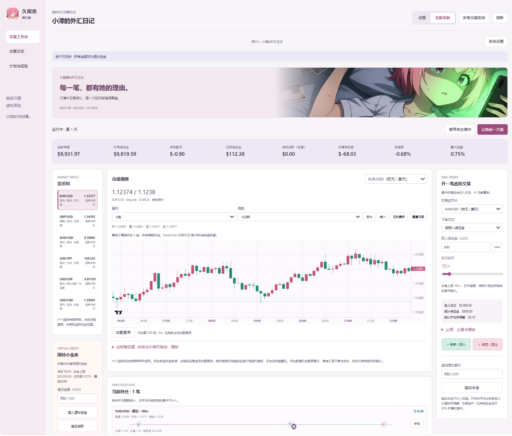

# 久留美模拟器

让 AI 带着自己的性格，在真实外汇行情里玩一局虚拟交易。给她一笔本金，陪她聊天、看盘、复盘，看看最后会留下怎样的收益和日记。

**当前正式版：v1.1.0** · AstrBot 插件 · 自带交易面板

资金和交易全部在插件内模拟，不向券商发送订单。

*用户提供的界面截图。截图来自此前界面；v1.0.0已移除“暂停自主操作”，手动看盘改为排队执行。*

## 可以怎么玩

- 为不同用户创建多个独立实例，设置初始本金、货币对、杠杆、手续费和结束条件。
- 做多、做空、止盈止损、模拟强平、追加虚拟本金，以及带利息的虚拟借款。
- 在QQ私聊等已绑定会话中，让AI通过工具查账户、看日志、开平仓、改保护线和写交易计划；操作保留简短理由。
- 带着原有人格、授权聊天和交易记忆自主看盘。手动、定时及风险触发共用持久队列和频率上限。
- 止损、止盈、强平、保证金不足和本局结束可主动请求LLM复盘；已结束账户只读，不再交易。
- 自动写每日经验日记，将交易与真实互动串起来；串行生成，失败和漏写可补写。

## 交易面板与行情

AstrBot插件视图内提供交易工作台、交易日志、计划与经验。K线、折线、面积图等可切换，支持多周期和坐标轴操作。

实时数据可选 **biquote、新浪外汇或OANDA Practice**。免注册来源无需行情Key，OANDA需要Practice账户和令牌。历史参考汇率默认Frankfurter，只用于日/周/月参考图，不用于成交或分钟OHLC。

同一行情来源、货币对和周期的K线由全部实例共享，本地优先、持久保存；已有历史不重复整段下载，缺失区间和最新数据按需补充。

## 安装

需要 **AstrBot >= 4.29.3**。

1. 在AstrBot插件管理中通过本仓库地址安装，或从 [Releases](https://github.com/myWorldmakerTonyczk/astrbot_plugin_kurumi_simulator/releases) 下载插件ZIP并上传安装。
2. 确认依赖安装完成，加载插件后打开插件的交易面板。
3. 在「设置 → API与行情连接」选择行情源和LLM；平台模型需手动选择，也可填写支持工具调用的OpenAI兼容接口。
4. 创建交易实例时绑定完整私聊 UMO，或从已有用户卡片直接新增实例。
5. 新建实例时必须选择有效的 AstrBot 人格；定时看盘默认开启，默认每小时一次（以管理员间隔设置为准）。需要参考聊天时，再在实例设置授权主参考会话。

新建实例表单使用 UMO 绑定。已有 QQ 和随机 ID 绑定仍可使用。需要关联主参考私聊时，可先在该私聊通过交易工具选择实例。

## 几项默认设置

| 项目 | 默认值 |
| --- | --- |
| 定时自主看盘 | 关闭，开启后默认每1小时一次 |
| 用户自行修改看盘间隔 | 不允许；管理员可开放，两处同步，最小10分钟 |
| 看盘任务限频 | 每实例最短10分钟、滚动1小时最多6次 |
| 风险事件触发LLM | 开启，可分别控制 |
| 看盘完成后向用户汇报 | 关闭 |
| 指定汇报时段、随机延迟 | 关闭 |
| 爆仓、保证金等风险通知 | 开启，但须有关联私聊 |
| 主动消息免打扰 | 00:00～07:00，爆仓消息也不例外 |
| 每日日记 | 00:10写前一天；交易操作日志须大于2条 |
| 无交易但有聊天也写日记 | 关闭 |
| 控制台完整提示词日志 | 关闭，可在API设置页临时开启 |

风险触发LLM与给用户发消息是两条流程：内部分析可在夜间运行，所有主动用户消息仍须遵守免打扰。日记只使用启用后能可靠按日期归档的授权对话，不编造缺失旧聊天。

## 用户、权限和数据

用户卡片默认收起，可改名、刷新随机ID、查看绑定与实例、限制实例数量，以及管理间隔和通知修改权限。删除用户前需要确认；确认后删除其全部实例与关联记录，不影响其他用户。

面板由AstrBot控制台登录保护，控制台管理员可以管理所有实例；聊天工具按用户归属隔离。没有另行开放一个匿名网页交易面板。

账本、历史K线、日记、队列与设置保存在插件数据目录的SQLite数据库中。数据库含接口凭据，应保留在服务器，不提交到公开仓库。

## 功能说明

- [用户权限、模型接口、主动汇报与调试](docs/SETTINGS.md)
- [手动/定时/风险看盘、限频与共享K线缓存](docs/DECISIONS.md)
- [每日日记、资料范围和补写](docs/DIARY.md)
- [源码结构](src/README.md)
- [配图说明](docs/ARTWORK.md)
- [AI 复盘、聊天发图和独立用户面板](docs/PORTAL.md)
- [更新记录](CHANGELOG.md)

角色素材由用户提供，相关角色与素材版权归原权利人。图表使用Lightweight Charts，许可证随插件保留在views/dashboard/vendor。

## 开发验证

离线测试：`python -m unittest discover -s tests -q`。另有真实AstrBot运行时、离线模型工具循环和浏览器验证脚本；它们需要本地安装对应框架/浏览器依赖。已验证规则与接口，不代表已使用所有真实模型、行情服务或聊天平台进行线上测试。

## 联系方式

邮箱：[tonyczk3032@outlook.com](mailto:tonyczk3032@outlook.com)
